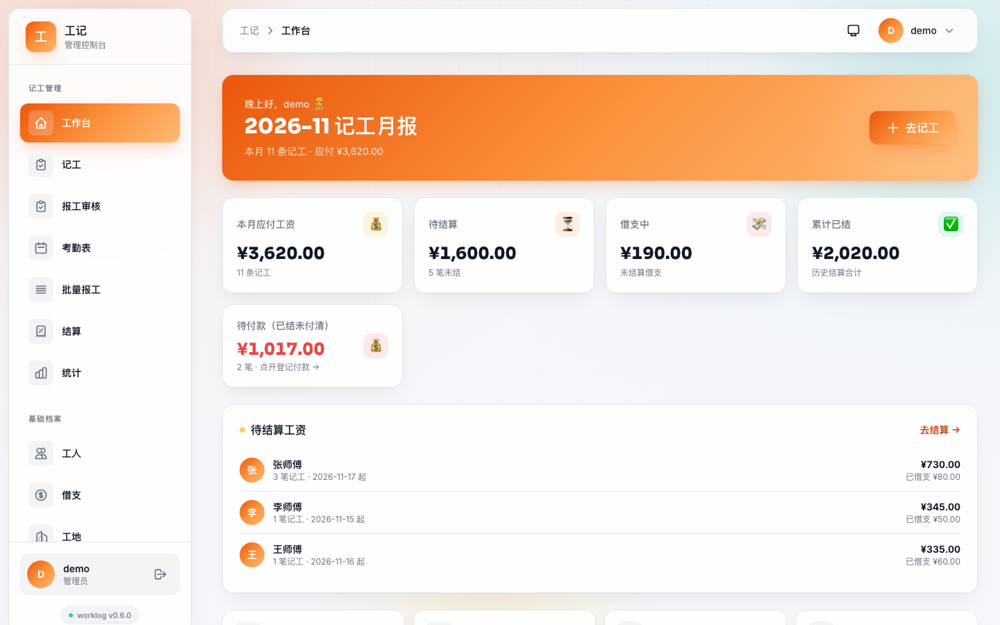
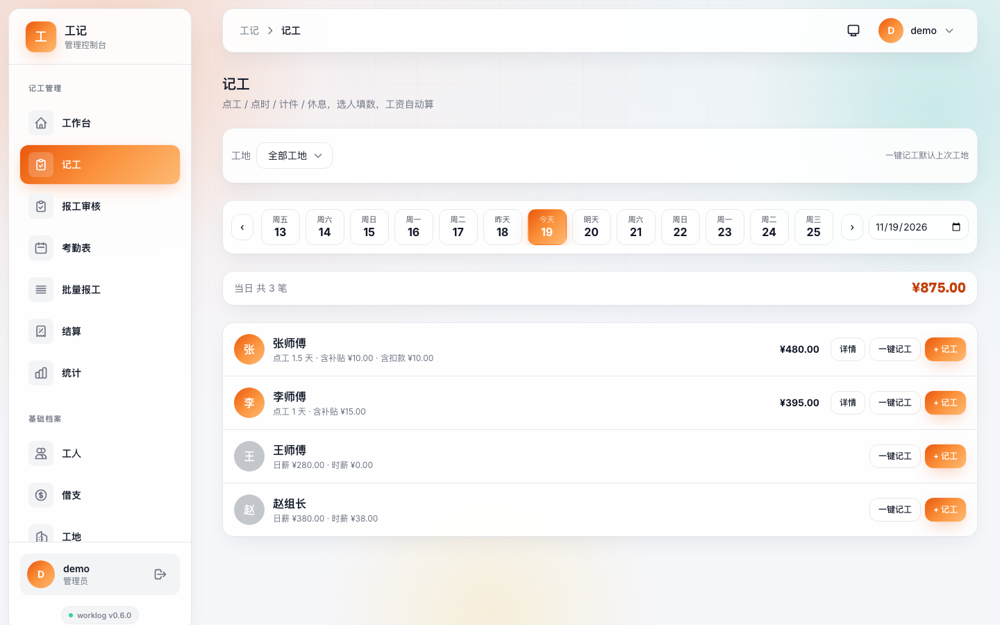
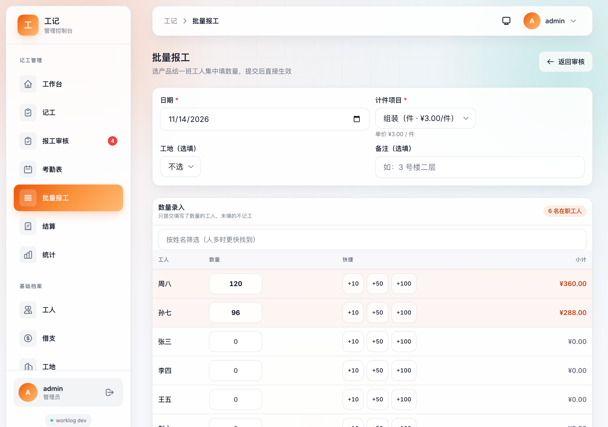
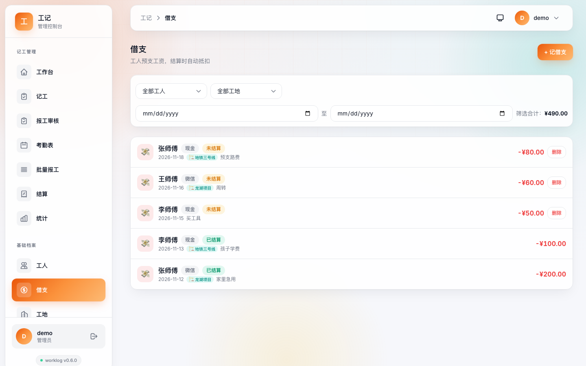
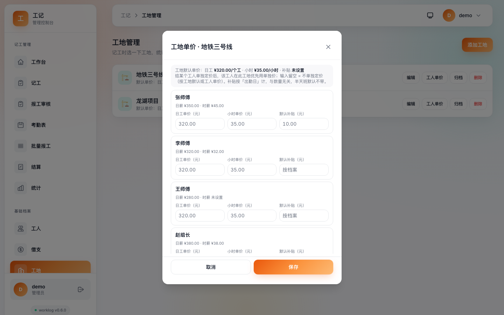
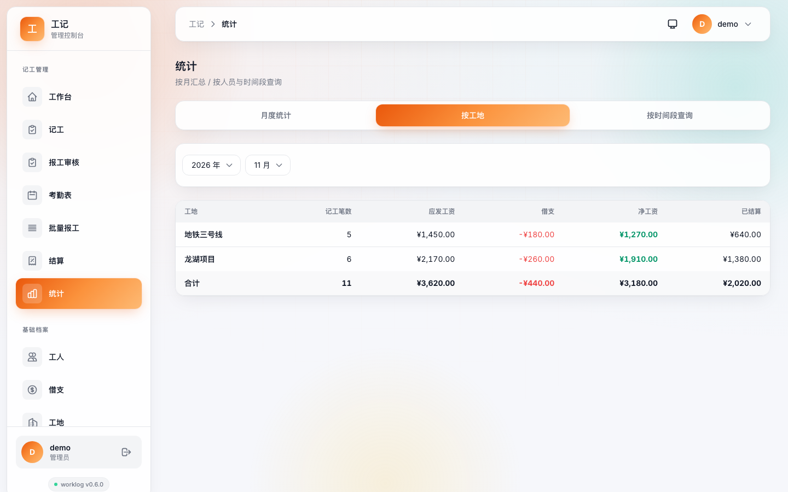
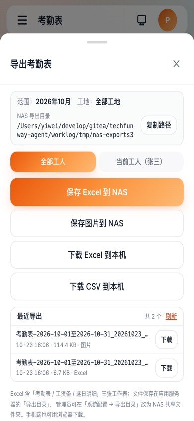

# 工记 WorkLog

记工记账应用，面向班组 / 包工头 / 个体用工：**按天、按时、计件记工，工资自动计算**，
借支与结算管理，一键月结并生成工资条，支持数据导出备份。

在飞牛 fnOS 上可通过 NAS 账号一键登录；也支持 Docker 与裸二进制部署。

**📖 怎么用**：见 [使用指南](docs/05-使用指南.md) —— 三分钟上手、扫码报工全流程（建码 / 报工地址 / 打印分发）、
报工审核与批量报工、考勤对工与导出到 NAS、结算与工资条、备份恢复，以及常见问题排查。

## 下载与安装

| 渠道 | 获取方式 |
|---|---|
| GitHub Releases | <https://github.com/TechFunWay/worklog/releases> —— 各平台压缩包、飞牛 `fpk` 安装包与 `docker-compose.yml` |
| Gitee 仓库 | <https://gitee.com/TechFunWay/worklog> —— 源码与标签镜像，不单独提供发行版；安装包请用 GitHub Releases |
| Docker 镜像 | `docker pull techfunways/worklog:latest`（amd64 / arm64 多平台） |
| 飞牛 fnOS | 在飞牛应用中心手动安装 Releases 里的 `.fpk` 安装包（amd64 / arm64） |
| 官网介绍页 | <https://techfunway.wycto.cn/fnapp/worklog> |

> 默认端口 `8909`；数据默认是挂载目录下的 SQLite 单文件，备份即拷贝，恢复支持上传本地备份文件。

## 界面预览

> 以下截图取自 v0.5.0（部分旧页面为 v0.3.0 实拍），数据为演示用示例数据。

**工作台**：本月应付、待结算与借支提醒一目了然



**记工**：点工 / 点时 / 计件三种录入，计件项目自动带出默认单价



**扫码报工**：工人不用注册账号，扫工位二维码只填数量，产品名自动带出；提交后由班组长审核

<p>
  
  
</p>

**报工审核 / 批量报工**：待审记录逐条或批量确认，也可按产品给整班工人集中代录

<p>
  
  
</p>

**工人与借支**：一个工人一条档案（日薪 / 时薪 / 月薪，可绑应用账号）；借支按现金 / 微信 / 支付宝记账，结算自动抵扣

<p>
  
  
</p>

**工地与单价**：工地可设默认日工 / 小时单价，同一工人可按工地单独定价，记工自动带出（优先级 手动 > 工地工人价 > 工地默认价 > 工人档案）



**考勤表**：整月出勤日历与当月工钱汇总，任意日期可点进记工，支持导出考勤表


**我的班组**：可建多个班组并随时切换，给每个成员设日薪/时薪


**结算**：未结算汇总按人核对应发、借支与净应付


**统计**：月度统计与自定义时间段查询



**深色主题**：工地夜间也能看清记工明细


**手机端**（390 × 844）：工作台、记工、报工审核（底栏带待审角标）、考勤与班组

<p>
  
  
  
  
  
  
</p>

**数据备份与恢复**：导出 CSV / JSON 与数据库快照，支持从本地上传备份文件恢复（换机迁移），恢复前自动做安全快照


其余截图见 [images/screenshots/](images/screenshots/)，同一套图也随发行目录分发（`release/<版本>/screenshots-<版本>.zip`）。

## 功能

### 记工（核心）
- 三种计薪方式：点工（按天，支持半天）/ 点时（按小时）/ 计件（数量 × 单价）
- 单价自动带出：工人默认日薪 / 时薪、计件项目默认单价，单条可覆盖
- 工资实时计算，服务端以整数「分」存储，避免浮点误差
- 日历式记工页，移动端优先，30 秒完成一笔录入
- 工地 / 项目维度（选填），统计可按工地筛选
- **工地上下文切换**：记工页可按工地筛选当日记录与合计，新记工默认落到当前工地；工地选项默认上次
- **一键记工**：按当前（或上次）工地 + 点工 1 天 + 工人默认单价直接记一笔，不弹窗；月薪工自动折算
- 休息标记、多天连记、确认并再记一笔

### 扫码报工与审核（工厂计件场景）
- **报工码**：老板/组长为产品（计件项目）生成二维码，工人用手机扫码，**免登录**、不装应用、不用飞牛账号
- 报工码可只绑产品、只绑工人，或**产品 + 工人双绑定**：双绑定后扫码只剩「数量」一个输入框，产品名自动带出
- 支持打印海报或「每人一张专属码」；专属码会把工人和产品预设好，贴在工位/发到群里即可
- 提交默认进入**待审核**，班组长在「报工审核」里逐条或批量通过/驳回；只有审核通过的记录才计入考勤、统计、结算与工资条
- 员工在应用内自己记工也可按班组开关决定是否先待审（班组设置里可开关）
- **批量报工**：班组长选产品与日期，给一班工人集中填数量，一次提交直接生效，适合收工后统一代录
- 公网 / 内网均可：同一套页面，用工人手机能打开的地址（内网 IP:端口或公网直连）生成二维码即可；飞牛网关地址需要 NAS 登录，页面内会提示改用直连地址
- 报工接口按出口 IP 单独放宽限流（默认 300+ 次/分钟），几十台手机共用一个车间 Wi-Fi 也能正常交班报工

### 考勤与对工
- 考勤表：月历展示每个工人的出勤（1个工 / 0.5个工 / 小时 / 件 / 休），月度汇总工钱；任意日期可点进记工
- **按工地看考勤**：考勤表可切换工地（含「未分工地」），日历与汇总只显示该工地
- **自定义时间段查询**：按起止日期（快捷：本月 / 上月 / 近7天 / 近30天）查看每位工人的考勤天数、点工折合、计时、计件、休息与工钱
- **一键对工**：为某个工人某段时间生成对工单（明细 + 合计），可复制中文文本发微信给工人核对，或下载 CSV 存档
- **导出 Excel 到 NAS**：按整月或自定义时间段生成 Excel，含「考勤表 / 工资条 / 逐日明细」三张工作表；保存到服务器导出目录（默认 `<数据目录>/exports`），适合直接指向 NAS 共享文件夹归档
- **导出考勤表图片到 NAS**：月度考勤表一键渲染成 PNG 存到同一目录（`pictures/` 子目录），可直接发微信或相册
- **最近导出**：弹窗内查看、下载、删除最近 100 个导出文件（老板 / 班组长）
- 管理员可在「系统管理 → 系统配置 → 导出目录」把保存位置改成 NAS 共享文件夹（绝对路径）；本机 CSV / Excel 仍由浏览器保存到「下载」文件夹

### 角色与班组（v0.2 起，v0.3 增强）
- 老板 / 组长 / 员工三种角色：老板建班组，凭邀请码加入；管理员也可在用户管理里把已有账号直接加入班组
- **可创建多个班组**并随时切换，每个班组独立维护邀请码、成员与备注
- **成员单价**：给每个成员设日薪/时薪，记工时自动带出
- 组长可帮工人记工、记借支；**员工只能给自己记工**，可查看自己的考勤、工资、结算单

### 结算与工资条
- 未结算汇总：按工人实时汇总应发、借支、净应付
- 单人结算 / 一键月结，结算后记录锁定，可撤销重结
- 未结工资可按人结算，也可按项目（工地）结算
- 工资条：明细 + 借支抵扣 + 实发 + 签字栏，一键导出 PNG 图片（微信直接发给工人）或复制文字
- 已结账记录：按工人 / 时间段查询，导出 CSV

### 借支
- 记录工人预支（现金 / 微信 / 支付宝），结算时自动抵扣

### 统计
- 月度统计：每人工人出勤天数、工时、计件数量、应发工资、借支、净额
- 按人员 + 时间段自定义查询，明细与汇总，CSV 导出

### 数据安全
- 所有数据本地 SQLite（WAL 模式），不联网、不上报
- 数据按用户隔离，多用户互不可见
- CSV / JSON 导出，管理员可下载数据库快照备份

### 账号与安全
- 用户名密码注册登录，第一个注册用户自动成为管理员
- 飞牛 fnOS NAS 账号一键登录（自动绑定 / 注册）
- 管理员：用户管理、系统配置、审计日志

## 技术栈

- 后端：Go、Gin、GORM、SQLite（WAL），模块化应用注册（`server/worklog/`）
- 前端：Vue 3、TypeScript、Vite、Pinia、Tailwind CSS，深浅色双主题
- 默认端口：`8909`；默认数据库路径：`data/db/worklog.db`

## 本地运行

```bash
make dev        # 构建前后端并启动（模拟生产目录结构）
# 或分别构建
make build      # 前端 + 后端
./worklog -data-dir ./data -port 8909
```

## Docker 部署

```bash
docker compose up -d          # 端口 8909，数据卷 worklog-data
```

## 飞牛 fnOS 打包

```bash
make fnpack    # 产出 release/<版本>/techfunway-worklog.fpk（amd64 + arm64）
```

## 文档

| 文档 | 内容 |
|---|---|
| [docs/05-使用指南.md](docs/05-使用指南.md) | **怎么用**：上手、记工、扫码报工与审核、批量报工、考勤对工与导出、结算、备份恢复、常见问题 |
| [docs/01-需求分析.md](docs/01-需求分析.md) | 需求与场景边界 |
| [docs/02-概要设计.md](docs/02-概要设计.md) | 模块划分与接口形态 |
| [docs/03-详细设计.md](docs/03-详细设计.md) | 数据模型与实现说明 |
| [docs/04-角色与考勤设计.md](docs/04-角色与考勤设计.md) | 角色权限、班组与考勤日历设计 |
| [CHANGELOG.md](CHANGELOG.md) | 各版本更新日志 |

## 支持作者

如果工记帮到了你，欢迎微信扫码请作者喝杯咖啡——金额随意，1 元也是心意：

<p align="center">
  
</p>

应用内的赞赏入口（启动弹窗、顶部横幅、支持入口）随时可用；支持记录按版本号记忆，升级到新版本后会再次提醒。支持完全自愿，不支付不影响任何功能。
